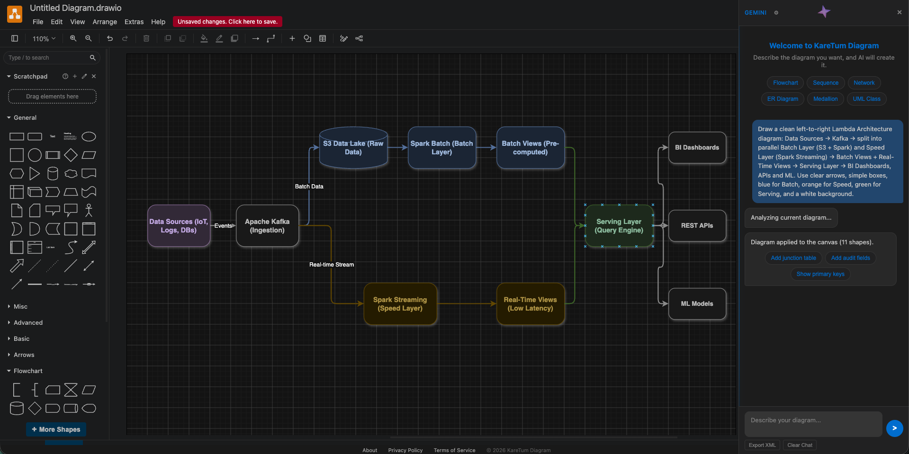

# KareTum Diagram

[](LICENSE)
[](https://nodejs.org)
[](#contributing)
[](#adding-api-keys-tokens)

AI-powered diagram tool built on draw.io. Create flowcharts, sequence diagrams, UML, ER diagrams, and more using natural language.

## Screenshot



> Placeholder — add a screenshot or GIF of the AI chat generating a diagram. Save it as `docs/screenshot.png` at the repo root (or update the path above). Visual demos drive adoption.

## Features

- AI-powered diagram generation (Google Gemini, OpenAI GPT, Anthropic Claude, Ollama, custom endpoints)
- Full draw.io editor compatibility
- Export to SVG, PNG, XML, PDF
- Dark/light theme support
- Server-side API proxy so keys are never exposed to the browser
- No ads — clean, distraction-free UI

## Quick Start (run locally)

Follow these steps to run KareTum Diagram on your machine.

### Step 1 — Prerequisites

- **Node.js 18+** (check with `node -v`)
  - macOS: `brew install node`
  - Ubuntu/Debian: `sudo apt install nodejs`
  - Or download from [nodejs.org](https://nodejs.org)
- **git**

### Step 2 — Clone and enter the app directory

```bash
git clone https://github.com/YOUR_USER/drawio.git
cd drawio/src/main/webapp
```

> All commands below run from `drawio/src/main/webapp`.

### Step 3 — Create your `.env` file

Copy the template, then edit it with your keys:

```bash
cp .env.example .env
```

Open `.env` and set the keys for the provider(s) you want to use:

```dotenv
# Google Gemini — https://aistudio.google.com/apikey
GEMINI_API_KEY=your-gemini-key

# Optional: several Gemini keys, comma-separated (rotated on rate limits)
# GEMINI_API_KEYS=key1,key2,key3

# OpenAI / GPT — https://platform.openai.com/api-keys
OPENAI_API_KEY=sk-...

# Anthropic / Claude — https://console.anthropic.com/settings/keys
ANTHROPIC_API_KEY=sk-ant-...

# Local Ollama endpoint (no key needed)
OLLAMA_URL=http://localhost:11434

# Server port
PORT=8080
```

Notes:
- You only need **one** provider to get started. Leave the others blank.
- `.env` is gitignored — your keys are never committed.
- Keys are loaded by `server.js` on startup and stay on the server.
- For **Ollama**, omit keys and run `ollama pull qwen3-coder-128k` first.
- Prefer not to use a file? You can instead paste keys in the app: chat panel → ⚙ → provider → **API Key** → **Save & Apply** (stored in browser `localStorage`).

### Step 4 — Start the server

```bash
node server.js
```

You should see:

```
KareTum Diagram server running:
  Local:   http://localhost:8080
  Network: http://192.168.x.x:8080
  Providers configured:
    Gemini:    1 key(s)
    OpenAI:    yes
    Anthropic: no key (enter in Settings)
    Ollama:    http://localhost:11434
```

The **Providers configured** lines confirm which keys were detected from `.env`.

### Step 5 — Open the app

Go to **http://localhost:8080** in your browser.

### Step 6 — Pick a provider

Click the floating star (bottom-right) to open the chat panel → gear icon ⚙ → select **Google Gemini / OpenAI / Anthropic / Ollama / Custom** → **Save & Apply**. Then describe the diagram you want.

### Network Access (same WiFi)

The server listens on `0.0.0.0:8080`. Find your local IP:

```bash
# macOS
ifconfig | grep "inet " | grep -v 127.0.0.1

# Linux
hostname -I
```

Open `http://YOUR_IP:8080` on other devices (the startup log prints the Network URL for you).

### Troubleshooting

| Problem | Fix |
|---------|-----|
| `EADDRINUSE` on port 8080 | Stop the old process: `lsof -ti:8080 \| xargs kill -9` then restart. Or set `PORT=8081` in `.env`. |
| "No ... API key" error | Add the key to `.env` and restart, or paste it in Settings and click Save & Apply. |
| Changes to `.env` not picked up | Restart the server (keys load at startup). |
| Ollama "Not running" | Start Ollama (`ollama serve`) and pull a model: `ollama pull qwen3-coder-128k`. |
| Slow local model | Use `qwen3-coder-128k` — best XML quality; smaller models may output invalid draw.io XML. |

## Deployment

### Option 1: Vercel (Recommended)

1. Push to GitHub
2. Go to [vercel.com](https://vercel.com) → Import Project
3. Select your repo
4. Framework Preset: **Other**
5. Root Directory: `src/main/webapp`
6. Build Command: (leave empty)
7. Output Directory: `.`
8. Deploy

### Option 2: Netlify

1. Push to GitHub
2. Go to [netlify.com](https://netlify.com) → New site from Git
3. Build command: (leave empty)
4. Publish directory: `src/main/webapp`
5. Deploy

### Option 3: Docker

A `Dockerfile` and `docker-compose.yml` are included at the repo root. The container runs `node server.js` (static files + AI proxy).

```bash
# From the repo root
docker compose up -d --build

# Or with plain docker (pass keys as env vars)
docker build -t karetum-diagram .
docker run -p 8080:8080 \
  -e GEMINI_API_KEY=your-key \
  -e OPENAI_API_KEY=your-key \
  -e ANTHROPIC_API_KEY=your-key \
  karetum-diagram
```

`docker compose` reads a project-root `.env` for the variables. See `.env.example`.

> Note for Ollama inside Docker: set `OLLAMA_URL=http://host.docker.internal:11434` (macOS/Windows) or the host gateway IP on Linux.

### Option 4: VPS / Self-Hosted

```bash
# On your server
git clone https://github.com/YOUR_USER/drawio.git
cd drawio/src/main/webapp

# Install PM2 for process management
npm install -g pm2
pm2 start server.js --name karetum
pm2 startup
pm2 save

# Optional: Nginx reverse proxy for HTTPS
```

Nginx config:

```nginx
server {
    listen 443 ssl;
    server_name yourdomain.com;

    ssl_certificate /path/to/cert.pem;
    ssl_certificate_key /path/to/key.pem;

    location / {
        proxy_pass http://127.0.0.1:8080;
        proxy_http_version 1.1;
        proxy_set_header Upgrade $http_upgrade;
        proxy_set_header Connection 'upgrade';
        proxy_set_header Host $host;
        proxy_cache_bypass $http_upgrade;
    }
}
```

## Adding API Keys (Tokens)

Keys can be provided in **two ways**. Environment variables (`.env`) are recommended because they stay on the server and are never sent to browsers.

### Option A — `.env` file (recommended)

```bash
cd src/main/webapp
cp .env.example .env
# edit .env and paste your keys
node server.js
```

`.env` is gitignored, so your keys are never committed. `server.js` loads it automatically on startup.

```dotenv
# Keys
GEMINI_API_KEY=your-gemini-key
GEMINI_API_KEYS=key1,key2,key3        # optional: rotate multiple Gemini keys
OPENAI_API_KEY=sk-...
ANTHROPIC_API_KEY=sk-ant-...

# Server
PORT=8080

# Endpoints (override for proxies / Azure / self-hosted / Ollama host)
OLLAMA_URL=http://localhost:11434
# GEMINI_BASE_URL=https://generativelanguage.googleapis.com
# OPENAI_BASE_URL=https://api.openai.com/v1/chat/completions
# ANTHROPIC_BASE_URL=https://api.anthropic.com/v1/messages

# Default models
GEMINI_MODEL=gemini-3.6-flash
OPENAI_MODEL=gpt-4o
ANTHROPIC_MODEL=claude-sonnet-4-5
OLLAMA_MODEL=qwen3-coder-128k:latest

# Generation
AI_TEMPERATURE=0.3
AI_MAX_TOKENS=16384
GEMINI_MAX_TOKENS=65536
ANTHROPIC_MAX_TOKENS=8192

# Timeouts (ms) & retries
AI_TIMEOUT_MS=180000
GEMINI_TIMEOUT_MS=180000
OLLAMA_TIMEOUT_MS=300000
GEMINI_RETRIES=3
GEMINI_RETRY_DELAY_MS=3000

# Ollama tuning
OLLAMA_NUM_CTX=32768
OLLAMA_NUM_PREDICT=16384
OLLAMA_REPEAT_PENALTY=1.1
```

Every value is optional and falls back to a built-in default. The full list lives in [`.env.example`](.env.example). Non-secret defaults are exposed at `GET /api/config` and adopted by the UI on first load; secrets are never sent to the browser.

You can also export them as real environment variables (Docker, systemd, Vercel, etc.) — they take precedence over `.env`.

### Option B — Settings panel

Open the chat panel → gear icon (⚙) → choose a provider → paste the key into the **API Key** field → **Save & Apply**. These keys are stored in your browser's `localStorage` and sent through the local proxy only.

If both are set, the value typed in Settings wins.

### Provider setup

| Provider | Get a key | Notes |
|----------|-----------|-------|
| **Google Gemini** | [aistudio.google.com/apikey](https://aistudio.google.com/apikey) | Free tier available. Use `gemini-3.6-flash`. |
| **OpenAI (GPT)** | [platform.openai.com/api-keys](https://platform.openai.com/api-keys) | Models: `gpt-4o`, `gpt-4o-mini`, `gpt-4.1`, `o4-mini`. |
| **Anthropic (Claude)** | [console.anthropic.com/settings/keys](https://console.anthropic.com/settings/keys) | Models: `claude-sonnet-4-5`, `claude-opus-4-1`, `claude-3-5-haiku-latest`. |
| **Ollama (Local)** | none | Install [ollama.ai](https://ollama.ai), then `ollama pull qwen3-coder-128k`. Best local XML quality. |
| **Custom Endpoint** | depends on provider | Any OpenAI-compatible API (OpenRouter, Groq, Together, LM Studio, vLLM). Enter full URL, e.g. `https://openrouter.ai/api/v1/chat/completions`. |

#### Example: OpenAI GPT

```bash
# .env
OPENAI_API_KEY=sk-proj-xxxxxxxx
```

Then in Settings pick **OpenAI (GPT)** and set Model to `gpt-4o`.

#### Example: Anthropic Claude

```bash
# .env
ANTHROPIC_API_KEY=sk-ant-xxxxxxxx
```

Then in Settings pick **Anthropic (Claude)** and set Model to `claude-sonnet-4-5`.

#### Example: custom OpenAI-compatible (OpenRouter, Groq, etc.)

Settings → **Custom Endpoint**:

- Endpoint: `https://openrouter.ai/api/v1/chat/completions`
- API Key: your provider key
- Model: e.g. `openai/gpt-4o` or `meta-llama/llama-3.3-70b-instruct`

## Removed: ads

All ad panes, AdSense placeholders, and the `adsbygoogle` loader have been **removed** from the app. There is no ad space reserved and no third-party ad script is loaded. If you want to add ads later, create your own `<ins class="adsbygoogle">` elements and include the AdSense script in `<head>`.

## Project Structure

```
src/main/webapp/
├── index.html          # Main app (HTML + CSS + JS, AI chat + providers)
├── server.js           # Node.js server (static files + API proxy for all providers)
├── .env.example        # Template for API keys — copy to .env
├── .env                # Your keys (gitignored, never commit)
├── privacy.html        # Privacy Policy
├── terms.html          # Terms of Service
├── about.html          # About page
├── favicon-karetum.svg # Custom favicon
├── images/
│   └── karetum-logo.svg
├── js/
│   ├── bootstrap.js    # URL params parser
│   ├── main.js         # App loader
│   ├── app.min.js      # draw.io core
│   └── ...
└── styles/
    └── grapheditor.css # draw.io styles
```

## Roadmap

- [ ] More AI providers (Azure OpenAI, Mistral, Groq presets)
- [ ] Streaming responses
- [ ] Diagram templates gallery
- [ ] Export to Mermaid / PlantUML
- [ ] Multi-language UI
- [ ] Automated tests + CI

Have an idea? Open an issue.

## Contributing

Contributions are welcome!

1. Fork the repo and create a branch: `git checkout -b feat/my-feature`
2. Make your changes and test locally (`node server.js`)
3. Keep secrets out of commits — never commit `.env`
4. Commit with a clear message and open a Pull Request

Please follow our [Code of Conduct](CODE_OF_CONDUCT.md). To report security issues, see [SECURITY.md](SECURITY.md) (do not open a public issue for vulnerabilities).

## Acknowledgements

- [draw.io](https://github.com/jgraph/drawio) — the editor this project builds on
- [Google Gemini](https://ai.google.dev/), [OpenAI](https://openai.com/), [Anthropic](https://www.anthropic.com/), [Ollama](https://ollama.ai) — AI providers
- All contributors and the open-source community

## Developer

**Muniandi Baskaran**

- GitHub: [@muniandibaskaran](https://github.com/muniandibaskaran)
- LinkedIn: [muniandi-baskaran](https://www.linkedin.com/in/muniandi-baskaran/)
- Medium: [@muniandibaskaran](https://medium.com/@muniandibaskaran)
- Email: [muniandibaskaran@gmail.com](mailto:muniandibaskaran@gmail.com)

## License

Released under the [Apache License 2.0](LICENSE). Based on [draw.io](https://github.com/jgraph/drawio) (Apache 2.0 License).
